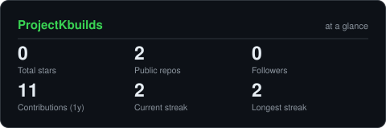
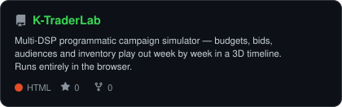

<div align="center">


<a href="https://github.com/ProjectKbuilds">

</a>

<a href="https://www.linkedin.com/in/kiran-kumar-reddy-b78774211"></a>
<a href="mailto:kiranbeeravelly07@gmail.com"></a>


</div>

## `~/` whoami

```
$ cat about.txt

Hi, I'm Kiran Kumar Reddy — Programmatic Advertising Specialist, New York.

- 5+ years running end-to-end programmatic campaigns: setup, targeting,
  bidding, pacing, trafficking, Floodlight tracking, brand safety, optimization
- Day to day: DV360, The Trade Desk, Amazon DSP, Google Ads — display,
  online video, audio, and connected TV (CTV)
- Now: Known, New York (May 2025–Present) — Slate, Publix, Shake Shack,
  Disney, MSK
- Before: Synechron (Bank of America, Mizuho) · Flipkart · DiLytics · LEJHRO
- Certified: DV360 · Google Ads Measurement · Google Ads Display ·
  Amazon Ads Campaign Planning · The Trade Desk Kokai (Zuma)
- Reporting: Microsoft Excel (PivotTables, VLOOKUP, conditional formatting)
- Open to relocate
```

## `~/` toolbox

<div align="center">


<br />


</div>

<sub>Only tools on my resume — and only ones I'd be happy to be asked about in an interview.</sub>

## `~/` skill radar

<div align="center">

<picture>
  <source media="(prefers-color-scheme: dark)" srcset="assets/radar-dark.svg" />
  <source media="(prefers-color-scheme: light)" srcset="assets/radar-light.svg" />
  
</picture>

</div>

<sub>Self-rated, from real day-to-day work — deliberately not maxed on every axis. A second radar drawn from live repo language data is intentionally omitted for now: this account has a single public repo in one language, and a one-axis chart would mislead. It gets added automatically once the account has 3+ languages.</sub>

## `~/` contribution calendar

<div align="center">


<picture>
  <source media="(prefers-color-scheme: dark)" srcset="https://raw.githubusercontent.com/ProjectKbuilds/ProjectKbuilds/output/snake-dark.svg" />
  <source media="(prefers-color-scheme: light)" srcset="https://raw.githubusercontent.com/ProjectKbuilds/ProjectKbuilds/output/snake.svg" />
  
</picture>

</div>

<sub>The 3D calendar and the snake are rebuilt on a schedule by GitHub Actions. Both appear after their workflows run once — the snake image 404s until then, which is expected.</sub>

## `~/` the numbers

<div align="center">

<picture>
  <source media="(prefers-color-scheme: dark)" srcset="assets/card-stats-dark.svg" />
  <source media="(prefers-color-scheme: light)" srcset="assets/card-stats-light.svg" />
  
</picture>

<picture>
  <source media="(prefers-color-scheme: dark)" srcset="assets/metrics.languages.svg" />
  
</picture>

<picture>
  <source media="(prefers-color-scheme: dark)" srcset="assets/metrics.achievements.svg" />
  
</picture>

</div>

<sub>Self-hosted graphics generated into this repo and refreshed daily — no third-party stats server that can go down. The language mix and achievements appear after the metrics workflow runs once.</sub>

## `~/` selected work

<div align="center">

<a href="https://github.com/ProjectKbuilds/K-TraderLab">
<picture>
  <source media="(prefers-color-scheme: dark)" srcset="assets/card-K-TraderLab-dark.svg" />
  <source media="(prefers-color-scheme: light)" srcset="assets/card-K-TraderLab-light.svg" />
  
</picture>
</a>

</div>

| project | live | stack |
| --- | --- | --- |
| **[K TraderLab](https://github.com/ProjectKbuilds/K-TraderLab)** — multi-DSP programmatic campaign simulator: set budgets, bids, audiences and inventory, then watch delivery, reach, frequency and CPM play out week by week in a 3D timeline | [Try it live](https://projectkbuilds.github.io/K-TraderLab/TraderLab_single.html) | HTML · JavaScript · Three.js |

<sub>All TraderLab data is synthetic and the model is labelled unvalidated — a learning and planning tool, not real campaign results. This account currently has one public repo, so this table grows as new work ships.</sub>

<!-- Local draft — nothing here is published until the full profile is approved. -->
